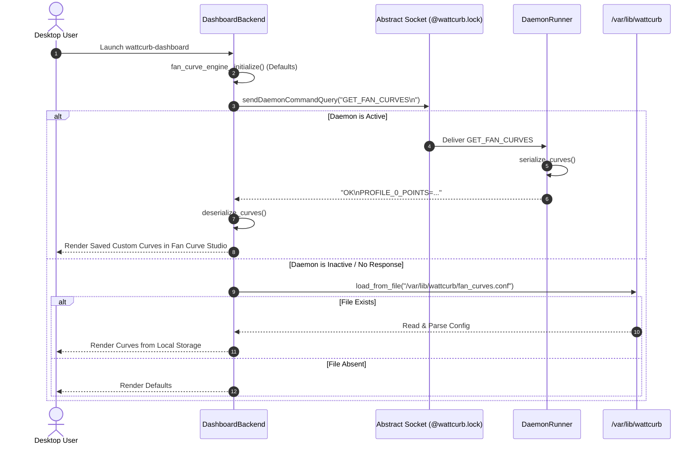
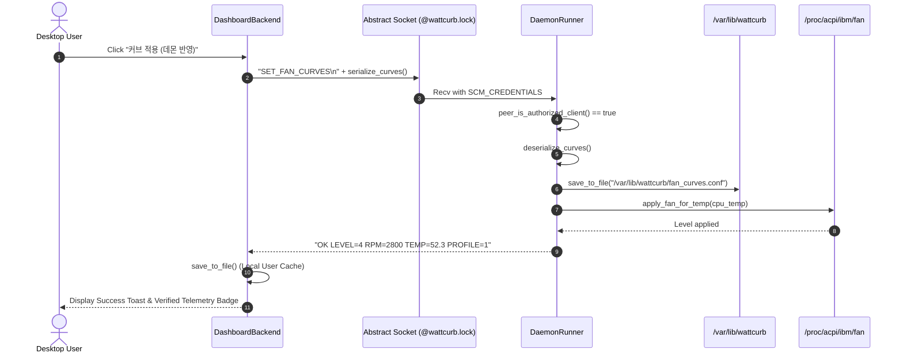

# [ARCH-092] Fan Curve StateDirectory Storage Topology & Bi-Directional IPC Synchronization Architecture

## 1. 개요 (Overview)

* **Ref-ID**: `REF-ARCH-092`
* **요구사항 참조**: [`REF-REQ-145`](file:///home/jedclub/Develop/WattCurb/docs/requirements/REQ-145-fan-curve-persistence-and-ipc-synchronization.md)
* **상위 아키텍처**: [`REF-ARCH-087`](file:///home/jedclub/Develop/WattCurb/docs/architecture/ARCH-087-ipc-mediated-fan-curve-persistence.md), [`REF-ARCH-088`](file:///home/jedclub/Develop/WattCurb/docs/architecture/ARCH-088-fan-curve-actuation-feedback-topology.md)
* **단위 테스트**: [`REF-TEST-099`](file:///home/jedclub/Develop/WattCurb/tests/test_units.cpp)

---

## 2. 파일 시스템 및 권한 토폴로지 (Storage Topology)

```
[Systemd Sandboxed Environment (wattcurb.service)]
  ├── ProtectSystem=full (/etc is mounted read-only: ro)
  └── StateDirectory=wattcurb (/var/lib/wattcurb is mounted read-write: rw, 0755)
        └── /var/lib/wattcurb/fan_curves.conf (PRIMARY PERSISTENCE PATH)
              ↑
              │ Writes allowed for Root Daemon
              │ Reads allowed for All Users (UID 1000 GUI Dashboard)

[User Session (wattcurb-dashboard)]
  └── ~/.config/wattcurb/fan_curves.conf (LOCAL USER FALLBACK CACHE)
```

### 2.1. 다계층 로드/세이브 사다리 (Multi-Tier Storage Ladder)
* **Load Ladder**:
  1. `/var/lib/wattcurb/fan_curves.conf` (데몬 영속 상태)
  2. `/etc/wattcurb/fan_curves.conf` (관리자 수동 구성 fallback)
  3. `$HOME/.config/wattcurb/fan_curves.conf` (사용자 캐시 fallback)
* **Save Ladder**:
  1. `/var/lib/wattcurb/fan_curves.conf` (root 데몬 쓰기)
  2. 실패 시 (권한 부재 등) `$HOME/.config/wattcurb/fan_curves.conf` (사용자 권한 쓰기)

---

## 3. IPC 시퀀스 다이어그램 (IPC Interaction Sequence)

### 3.1. 대시보드 부트스트랩 및 동기화 플로우



### 3.2. 커브 적용 및 영속화 플로우



---

## 4. 핵심 데이터 구조 및 함수 서명

```cpp
namespace wattcurb::policy {

class FanCurveEngine {
public:
    static constexpr const char* DEFAULT_CONFIG_PATH = "/var/lib/wattcurb/fan_curves.conf";
    static constexpr const char* FALLBACK_CONFIG_PATH = "/etc/wattcurb/fan_curves.conf";

    [[nodiscard]] static std::string resolve_user_config_path() noexcept;
    bool load_from_file(const char* path = nullptr) noexcept;
    bool save_to_file(const char* path = nullptr) const noexcept;
};

} // namespace wattcurb::policy
```
