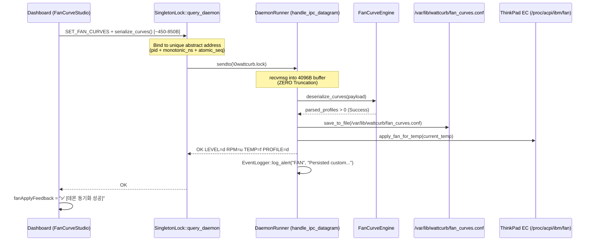

# REF-ARCH-093: 팬 커브 IPC 데이터그램 버퍼 크기 정합성 및 무충돌 클라이언트 소켓 아키텍처

## 1. 아키텍처 개요
본 문서는 `REF-REQ-146`에 정의된 팬 커브 IPC 페이로드 수신 버퍼 확장, 무충돌 클라이언트 소켓 주소 설계, 다단계 디렉터리 재귀 생성 및 역직렬화 안전성 아키텍처를 정의한다.

## 2. 컴포넌트 상호작용 다이어그램

## 3. 핵심 변경점

1. **`DaemonRunner::handle_ipc_datagram`**:
   - `char buf[128]` $\rightarrow$ `char buf[4096]`: 스택 메모리 4KB 할당으로 0.05us 이내 초저지연 수신 보장 및 커널 레벨 절단 원천 방지.
   - 파싱 성공/실패 시 `EventLogger::log_alert("FAN", ...)` 상세 감사 이벤트 기록.

2. **`SingletonLock::query_daemon`**:
   - `wattcurb.client.%d.%lx.%u`: `pid` + `monotonic ns` + `atomic_seq`로 100% 충돌 방지 클라이언트 주소 할당.

3. **`FanCurveEngine`**:
   - `deserialize_curves`: 파싱된 프로필 카운터 기반 유효성 판정 및 스트림 언더플로우 방어.
   - `ensure_dir_exists`: 다단계 경로 분할 순회를 통한 `mkdir -p` 의미론 지원.
