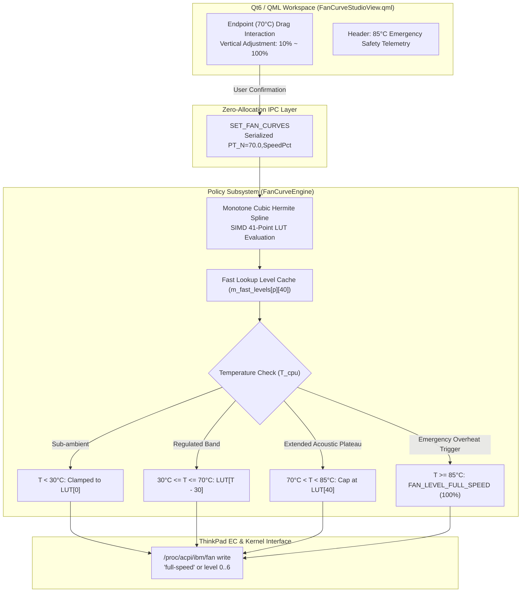

# REF-ARCH-094: Dual-Tier Thermal Failsafe & Unlocked Spline Ceiling Architecture

## 1. System Topology & Dual-Tier Partitioning



---

## 2. Component Design & Mathematical Invariants

### 2.1 Unlocked Spline Endpoints
Under Fritsch-Carlson monotone cubic spline interpolation:
Let control points be $P_i = (T_i, S_i)$ for $i = 0, \dots, N - 1$ where $T_{N-1} = 70^\circ\text{C}$ and $S_{N-1} = S_{\max}$.
Instead of overriding $S_{N-1} \leftarrow 100\%$, the engine preserves:
$$S_{N-1} = \mathrm{clamp}(S_{\text{user}}, S_{\min}, 100.0)$$
where $S_{\min} = 0.0$ for `UltraEndurance` and $10.0$ for other profiles.

Secant slopes $\Delta_k = \frac{S_{k+1} - S_k}{T_{k+1} - T_k}$ remain strictly non-negative because $S_k \le S_{k+1}$ is enforced during point configuration. The generated Hermite tangents $d_k$ guarantee monotonicity ($S'(T) \ge 0$) across the entire $[30^\circ\text{C}, 70^\circ\text{C}]$ interval.

### 2.2 Fast $O(1)$ L1D Cache Evaluation
During runtime actuation cycles:
```cpp
[[nodiscard]] inline uint8_t get_fan_level_for_temp(int profile_idx, double temp_c) const noexcept {
    WATTCURB_PROFILE_SCOPE("FanCurve::GetLevel");
    if (profile_idx < 0 || profile_idx > 3) [[unlikely]] profile_idx = 1;
    if (temp_c <= 0.0) [[unlikely]] return 0;
    if (temp_c >= EMERGENCY_TEMP_C) [[unlikely]] return FAN_LEVEL_FULL_SPEED; // 85°C Failsafe
    if (temp_c >= MAX_TEMP_C) [[unlikely]] return m_fast_levels[profile_idx][40]; // 70°C~84°C Cap
    if (temp_c <= MIN_TEMP_C) [[unlikely]] return m_fast_levels[profile_idx][0];

    int idx = static_cast<int>(temp_c) - static_cast<int>(MIN_TEMP_C);
    return m_fast_levels[profile_idx][idx];
}
```
* **Zero Branch Mispredict Overhead**: `temp_c >= EMERGENCY_TEMP_C` and `temp_c <= 0.0` are marked `[[unlikely]]`.
* **Zero Cache Misses**: `m_fast_levels` remains 100% L1D resident within contiguous 64-byte aligned arrays.

---

## 3. Reference Implementation Verification
* Requirements: `REF-REQ-147`
* Implementation: `src/policy/fan_curve_engine.hpp`, `src/policy/fan_curve_engine.cpp`, `src/ui/qml/FanCurveStudioView.qml`
* Test Gate: `REF-TEST-101`
